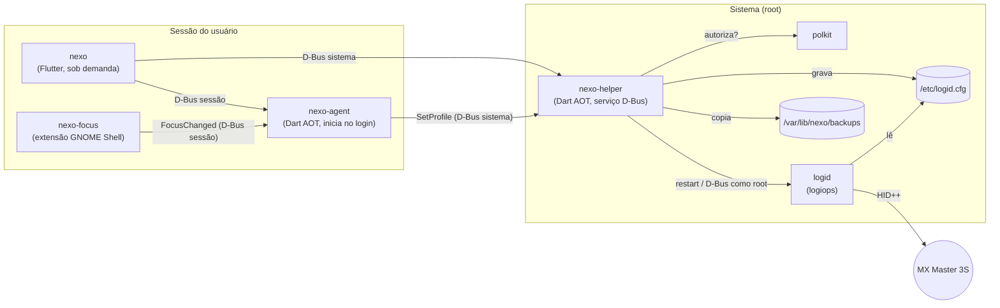

# Visão geral

**Status:** planejado (Fase 0). Atualize ao concluir cada fase.

## O problema

No Linux, mouses Logitech com HID++ 2.0 (como o MX Master 3S) são configurados pelo daemon
[`logid`](https://github.com/PixlOne/logiops), que lê um arquivo de texto (`/etc/logid.cfg`, formato
[libconfig](https://hyperrealm.github.io/libconfig/)). Editar esse arquivo à mão é trabalhoso e perigoso:
**um único erro de sintaxe faz o `logid` não iniciar**, e o mouse perde toda a personalização.

## A solução

O Nexo é uma interface gráfica que:

1. **Lê** a configuração atual e a mostra de forma visual (ilustração do mouse, cards, controles).
2. **Edita** um modelo tipado — estados inválidos não são representáveis.
3. **Gera** um `logid.cfg` sempre válido e o **aplica com segurança** (backup, escrita atômica,
   reinício do `logid`, verificação de saúde, rollback automático).
4. **Troca perfis** automaticamente conforme o aplicativo em foco, sem pedir senha.

O Nexo é pensado como um **hub de periféricos**: o módulo Logitech é o primeiro *adapter*; outros
(fones Bluetooth, headsets, RGB) e outros sistemas operacionais virão depois sem reescrever o núcleo.

## Peças e como conversam

- **`nexo` (UI):** só existe enquanto a janela está aberta. Não guarda estado crítico.
- **`nexo-agent`:** processo leve que vive durante a sessão. Mostra o ícone na bandeja, avisa bateria
  baixa e aplica as regras "aplicativo → perfil".
- **`nexo-helper`:** única peça com privilégios de root. Cada operação exige uma ação polkit específica.
- **`nexo-focus`:** no Wayland, aplicativos não podem saber qual janela está em foco; só o GNOME Shell
  sabe. A extensão apenas publica esse dado.
- **`logid`:** continua sendo quem fala com o mouse. O Nexo **não substitui** o logiops; ele o configura.

Detalhes de cada peça: [01-arquitetura/componentes.md](01-arquitetura/componentes.md).
Passo a passo dos fluxos: [01-arquitetura/fluxos.md](01-arquitetura/fluxos.md).

## Fases do projeto

| Fase | Entrega | Status |
|---|---|---|
| 0 | Fundação: ambiente, repositório, CI, documentação base, spikes no hardware | em andamento |
| 1 | Núcleo de configuração (parser, serializer, validador do `logid.cfg`) | — |
| 2 | Design system e protótipo visual (Bento + Palco) | — |
| 3 | Helper privilegiado (polkit, D-Bus, systemd, backup/rollback) | — |
| 4 | Casca do app e detecção de dispositivos | — |
| 5 | Editores do módulo Logitech | — |
| 6 | Agent, bandeja e perfis por aplicativo | — |
| 7 | Robustez e lançamento v1.0 (.deb) | — |

O plano completo e as decisões estão nos [ADRs](01-arquitetura/adr/README.md).
