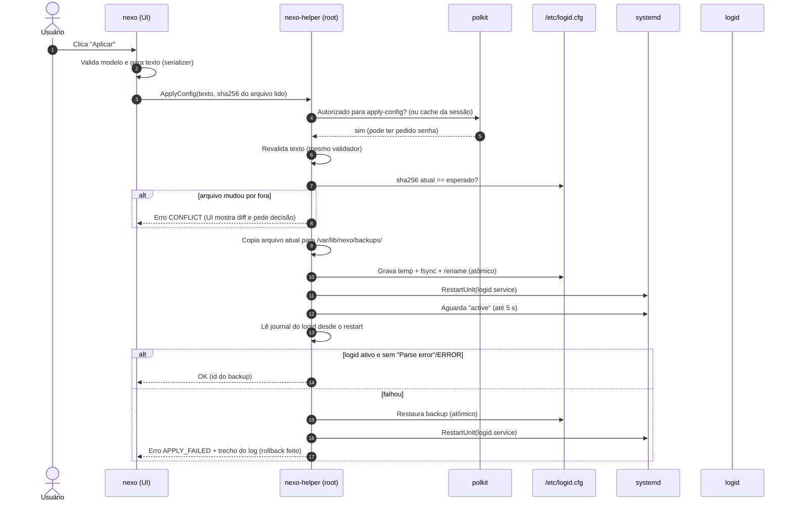
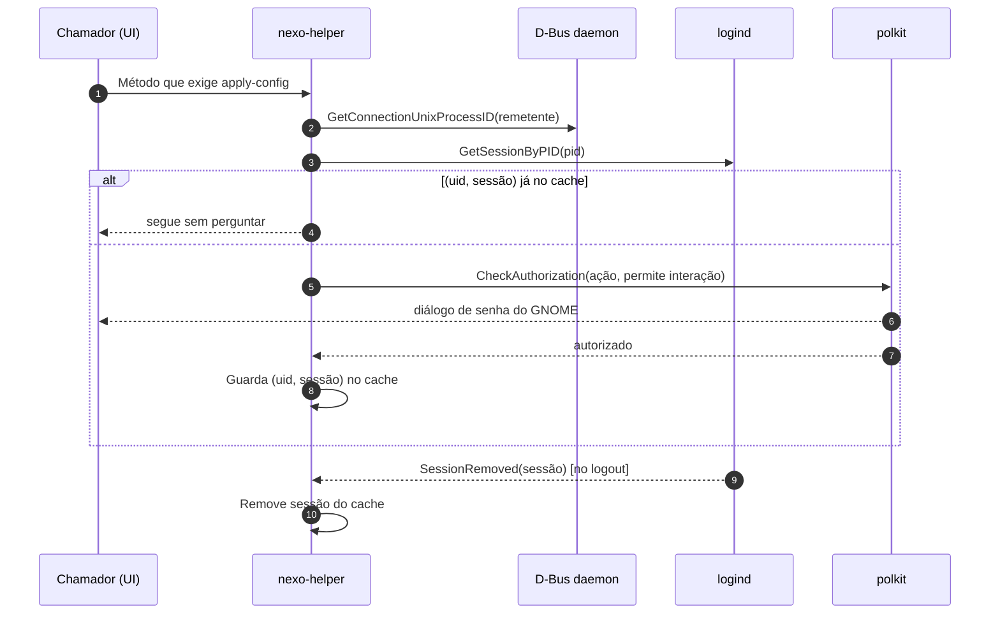
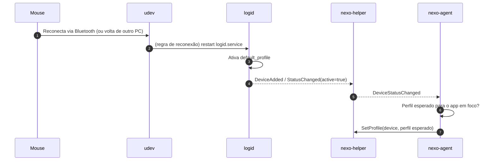
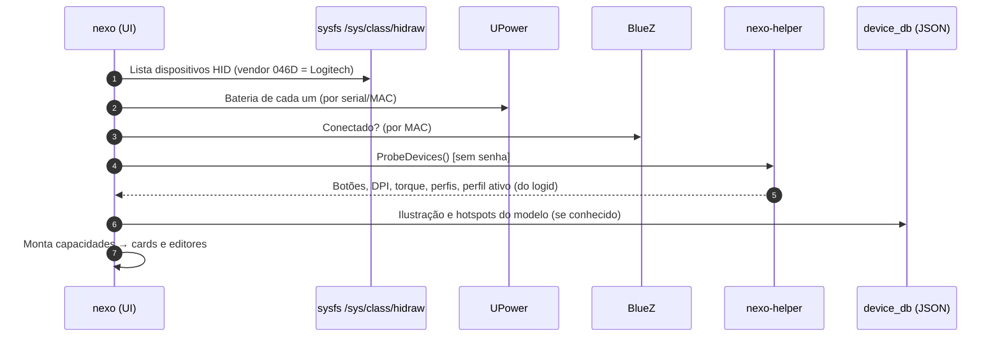

# Fluxos

**Status:** planejado. Cada diagrama vira `vigente` quando o fluxo for implementado e testado; ao
depurar, compare o log real com estes passos (os logs usam o mesmo **ID de correlação** em todos os
componentes — ver [logs-e-diagnostico.md](../04-operacao/logs-e-diagnostico.md)).

## 1. Aplicar configuração (com rollback)



## 2. Autenticação com cache por sessão



## 3. Troca de perfil por aplicativo

```mermaid
sequenceDiagram
    autonumber
    participant SH as GNOME Shell + nexo-focus
    participant AG as nexo-agent
    participant HP as nexo-helper
    participant LD as logid

    SH->>AG: FocusChanged("code.desktop", "Code")
    AG->>AG: Debounce 150 ms; casa regra → perfil "codigo"
    alt perfil desejado == perfil ativo
        AG->>AG: nada a fazer
    else
        AG->>HP: SetProfile(device, "codigo")   [sem senha]
        HP->>LD: GetProfiles()  (como root)
        alt "codigo" existe
            HP->>LD: SetProfile("codigo")
            HP-->>AG: OK
        else
            HP-->>AG: Erro UNKNOWN_PROFILE (nada é alterado)
        end
    end
```

## 4. Reconexão, reinício do logid e Easy-Switch



## 5. Detecção de dispositivos ao abrir a UI


